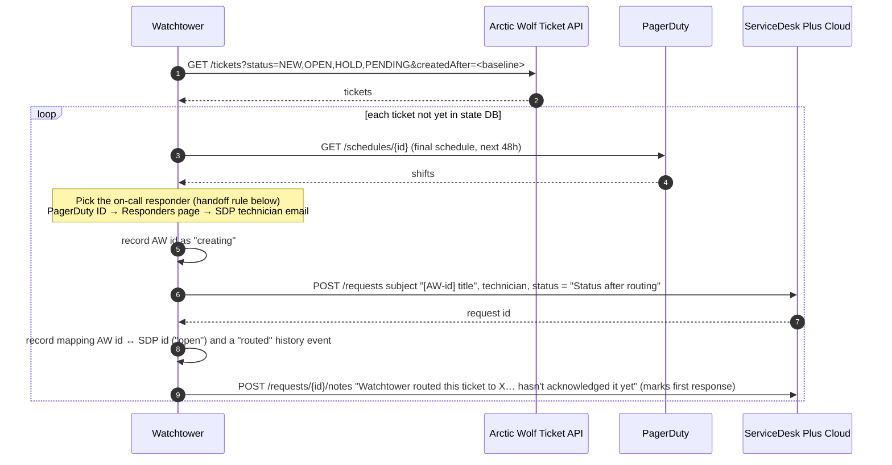
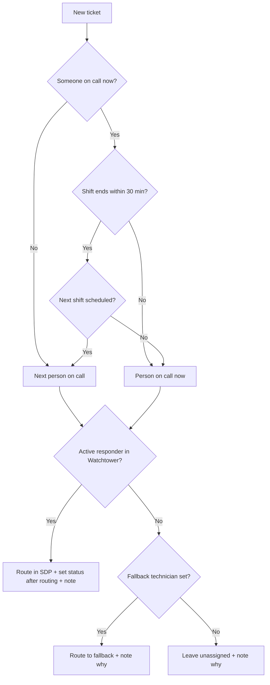

# How Watchtower works

Everything runs in one polling loop (default every 60 seconds) inside the same container
as the admin page. Each check re-reads the settings saved on the admin page, then runs
flows 1, 2 and 3 in order. Until the required credentials are saved, the loop waits.
Settings, encrypted credentials, the responder list, ticket state and routing history live in
SQLite (`/data/state.db`) in the `watchtower-data` volume.

## Flow 1: New Arctic Wolf ticket → SDP request, routed to the on-call responder



## Assignment rule



Back-to-back PagerDuty entries for the same person are merged first, so the
30-minute window is measured from the real end of their shift.

## Flow 2: SDP Resolved/Closed → close the Arctic Wolf ticket

```mermaid
sequenceDiagram
    autonumber
    participant S as Watchtower
    participant SDP as ServiceDesk Plus Cloud
    participant AW as Arctic Wolf Ticket API
    loop each mapping still "open"
        S->>SDP: GET /requests/{id}
        SDP-->>S: status, technician, resolution
        S->>S: refresh current owner + SDP status; log ownership and status changes
        alt status in close statuses
            S->>AW: POST /tickets/{awId}/close  {"comment": "Resolved in our SDP… Resolution: …"}
            S->>S: mark "aw_closed" (closed_by = sdp), log "resolved"
        end
    end
```

If the close call fails but Arctic Wolf already shows the ticket CLOSED, it is
marked done. Otherwise the error is recorded and retried next cycle. If reading the
request from SDP fails, the ticket is flagged "Out of date" on the overview.

## Flow 3: Arctic Wolf closed it first → note on SDP


## Ticket states

What's stored, and what the overview shows for it (`watchtower/status.py`). Watchtower
never shows "Acknowledged": it can see that a ticket was routed, but not that the
responder accepted it.

| Stored state | Shown as | Meaning |
|---|---|---|
| `creating` | Needs check | SDP create was attempted but the outcome is unknown (e.g. timeout). Never retried automatically, to avoid duplicates. Use `resolve-stuck`. |
| `failed_create` | Routing failed | SDP rejected the create. Retried every check. |
| `open`, with an owner | Routed | Assigned in SDP; waiting for a close status. |
| `open`, no owner | Unassigned | No eligible on-call responder, or the owner was removed in SDP. |
| `open`, SDP status is a close status | Resolving | Arctic Wolf ticket closes on the next check. |
| `open`, close failed | Close failed | Closing the Arctic Wolf ticket failed; retried every check. |
| `aw_closed` (by SDP) | Resolved | Resolved in SDP; Arctic Wolf ticket closed. |
| `aw_closed` (by Arctic Wolf) | Closed in Arctic Wolf | Arctic Wolf closed it first; the SDP request may still be open. |

Any open ticket whose last read from SDP failed, or is older than three checks, also
shows **Out of date**.

## Routing history

Every routing decision, ownership change, SDP status change, resolution, close and
failure is written to the `events` table and shown on the ticket page and under
Activity. Repeated identical failures are recorded once.
