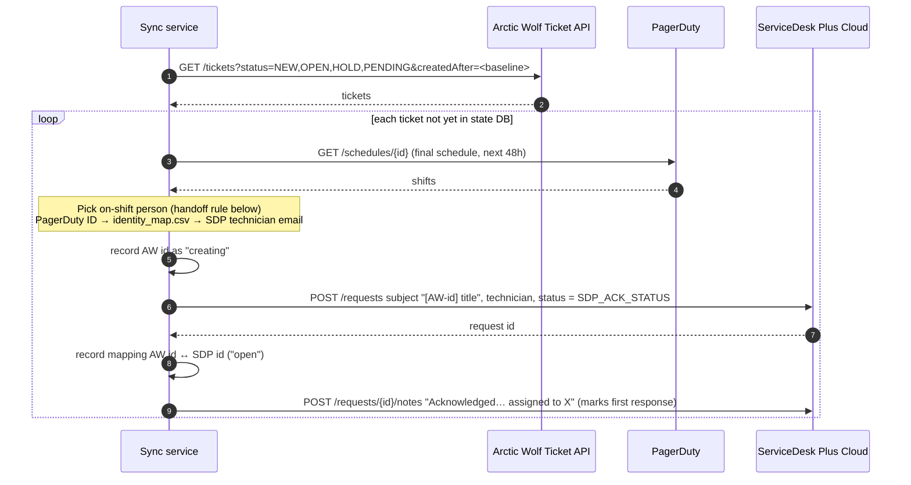
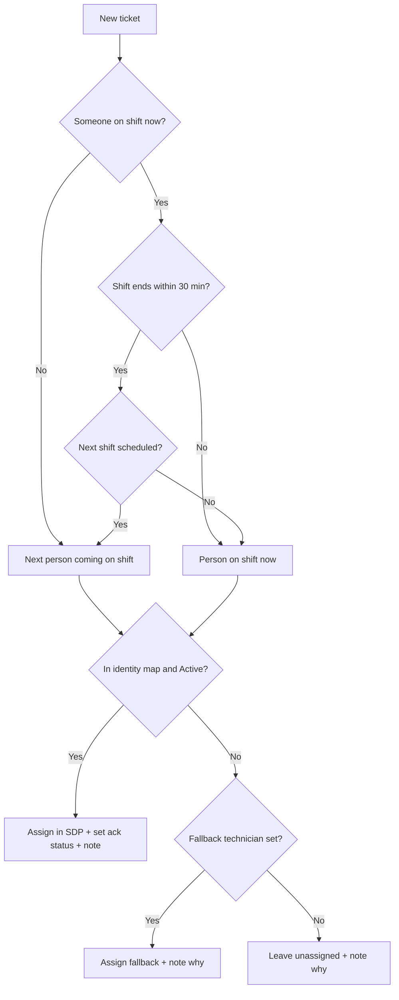
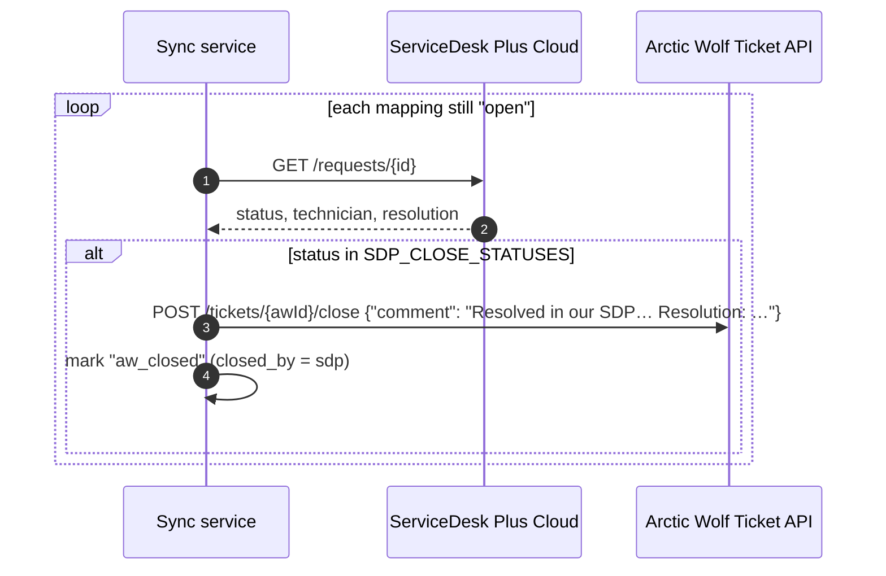
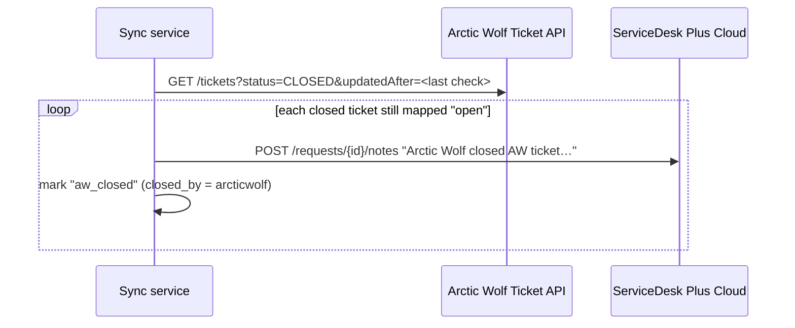

# Flows

Everything runs in one polling loop (default every 60 seconds). Each cycle runs
flows 1, 2 and 3 in order. State lives in SQLite (`/data/state.db`).

## Flow 1: New Arctic Wolf ticket → SDP request, assigned and acknowledged

## Assignment rule

Back-to-back PagerDuty entries for the same person are merged first, so the
30-minute window is measured from the real end of their shift.

## Flow 2: SDP Resolved/Closed → close the Arctic Wolf ticket

If the close call fails but Arctic Wolf already shows the ticket CLOSED, it is
marked done. Otherwise the error is recorded and retried next cycle.

## Flow 3: Arctic Wolf closed it first → note on SDP

## Ticket states in the DB

| State | Meaning |
|---|---|
| `creating` | SDP create was attempted but the outcome is unknown (e.g. timeout). Never retried automatically, to avoid duplicates. Use `resolve-stuck`. |
| `failed_create` | SDP rejected the create. Retried every cycle. |
| `open` | Mapped; waiting for SDP to reach a close status. |
| `aw_closed` | Arctic Wolf ticket is closed (by this service or by Arctic Wolf). |
